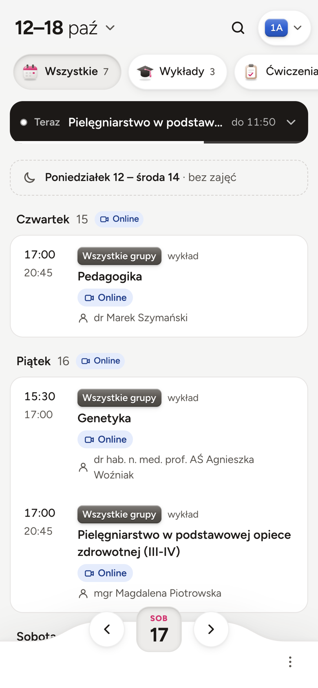
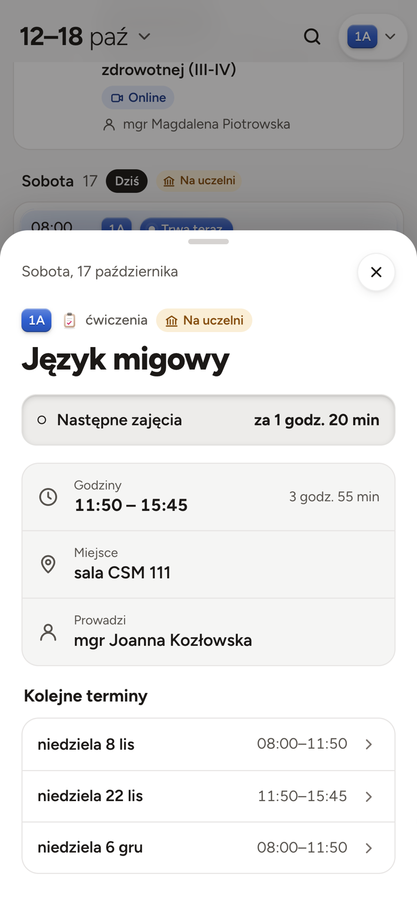
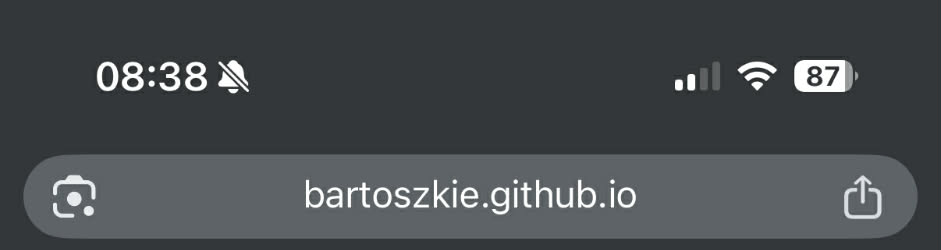
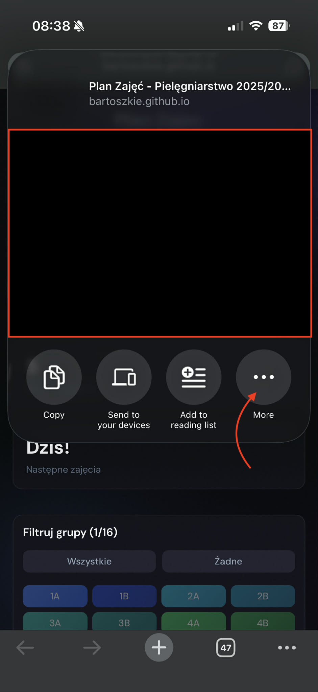
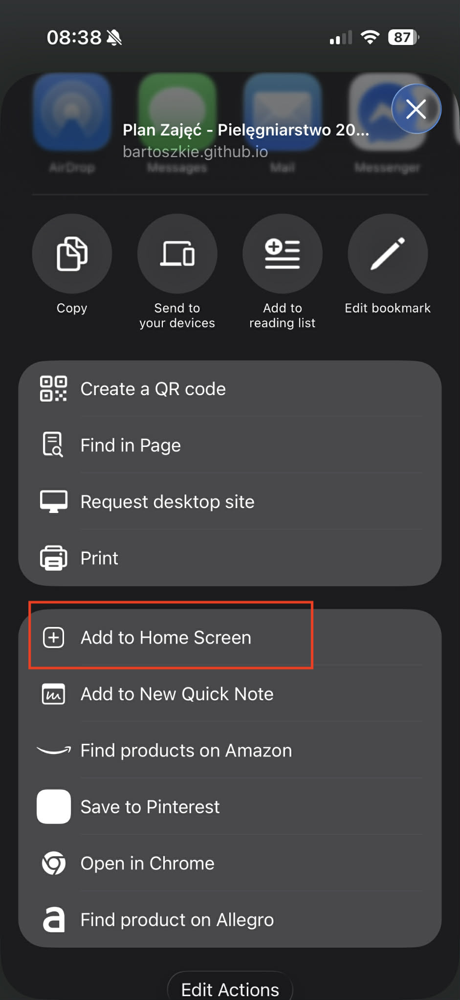
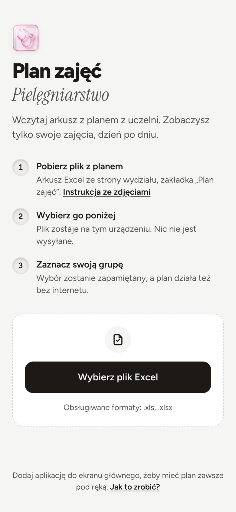
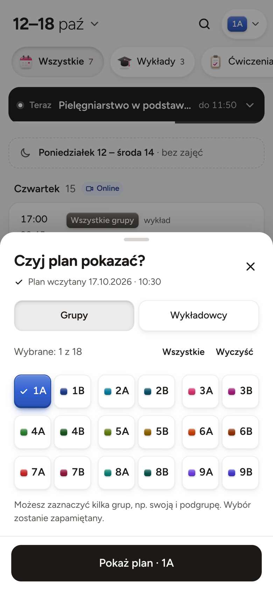
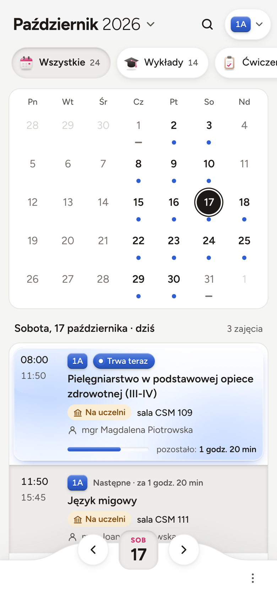
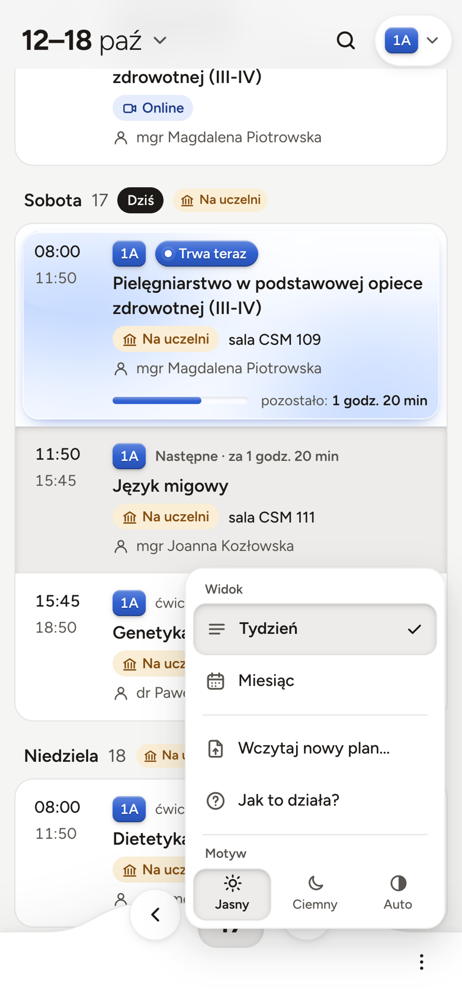
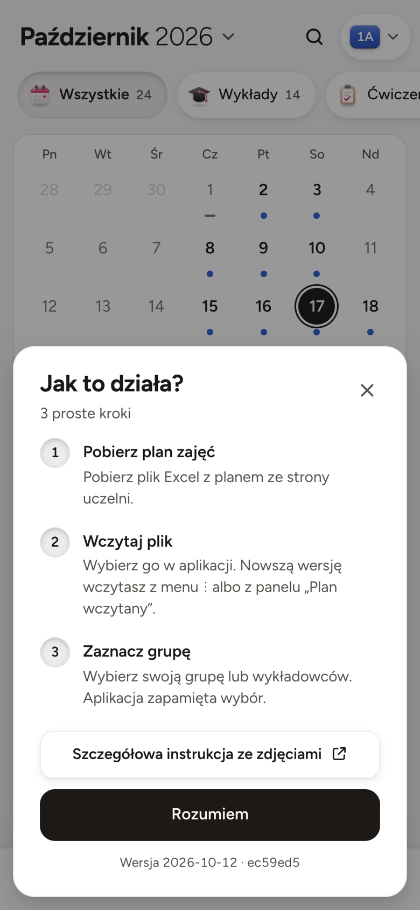

# Plan Zajęć · Pielęgniarstwo

Aplikacja do przeglądania planu zajęć dla studentów pielęgniarstwa. Wczytujesz arkusz Excel z planem z uczelni, wybierasz swoją grupę i widzisz tylko swoje zajęcia, dzień po dniu.

**👉 Otwórz aplikację: [bartoszkie.github.io/pielegniarstwo-lessons](https://bartoszkie.github.io/pielegniarstwo-lessons/)**

- Plik zostaje na Twoim telefonie: nic nie jest wysyłane i nie trzeba się logować.
- Po wczytaniu planu aplikacja działa też bez internetu.
- Najwygodniej korzystać z niej jak ze zwykłej aplikacji, z ikoną na ekranie głównym. Instrukcja jest poniżej.

<p>
  
  
</p>

---

## Instalacja na telefonie

Aplikację instaluje się prosto z przeglądarki, bez App Store i Google Play. Zajmuje to mniej niż minutę.

### iPhone (Safari lub Chrome)

1. Otwórz **[bartoszkie.github.io/pielegniarstwo-lessons](https://bartoszkie.github.io/pielegniarstwo-lessons/)** w Safari albo w Chrome.
2. Stuknij przycisk **Udostępnij** (kwadrat ze strzałką do góry):
   - w **Chrome** jest w pasku adresu, na górze ekranu;
   - w **Safari** jest na dolnym pasku. W nowszych wersjach iOS najpierw stuknij **⋯** obok paska adresu, a potem **Udostępnij**.

   

3. Jeśli na liście nie widać opcji z kolejnego kroku, stuknij **Więcej**.

   

4. Wybierz **Dodaj do ekranu początkowego**.

   

5. Zostaw nazwę **Plan Zajęć**. Sprawdź, że przełącznik **Otwórz jako aplikację internetową** jest włączony, i stuknij **Dodaj**.

   

6. Na ekranie głównym pojawi się ikona **Plan Zajęć**. Od teraz otwieraj aplikację z niej, a nie z przeglądarki.

> Zrzuty pochodzą z iPhone'a z angielskim językiem systemu. Po polsku przyciski nazywają się tak jak w opisie kroków.

### Android (Chrome)

1. Otwórz **[bartoszkie.github.io/pielegniarstwo-lessons](https://bartoszkie.github.io/pielegniarstwo-lessons/)** w Chrome.
2. Jeśli na dole ekranu pojawi się propozycja **Zainstaluj aplikację**, stuknij ją i przejdź do kroku 5.
3. W przeciwnym razie stuknij menu **⋮** w prawym górnym rogu.
4. Wybierz **Dodaj do ekranu głównego** lub **Zainstaluj aplikację**.
5. Potwierdź przyciskiem **Zainstaluj** (lub **Dodaj**).
6. Ikona **Plan Zajęć** pojawi się na ekranie głównym i na liście aplikacji.

---

## Jak korzystać z aplikacji

### 1. Pobierz plik z planem

Pobierz arkusz Excel (`.xls` lub `.xlsx`) z planem ze strony wydziału, z zakładki „Plan zajęć”. Zapisz go w telefonie, np. w aplikacji Pliki albo w Pobranych.

### 2. Wczytaj plik

Stuknij **Wybierz plik Excel** i wskaż pobrany arkusz. Na komputerze możesz też po prostu przeciągnąć plik do okna.



### 3. Zaznacz swoją grupę

Po wczytaniu pliku zaznacz swoją grupę. Możesz wybrać kilka, np. swoją i podgrupę. Na karcie **Wykładowcy** możesz zamiast tego wybrać prowadzących. Stuknij **Pokaż plan**. Wybór zostanie zapamiętany.

Grupę zmienisz później przyciskiem z jej nazwą w prawym górnym rogu (np. **1A**).



### 4. Przeglądaj plan

- **Tydzień:** zajęcia dzień po dniu. U góry widać, co trwa teraz i ile zostało do końca. Dni wolne są zebrane w jedną linijkę.
- **Filtry** pod nagłówkiem (**Wszystkie**, **Wykłady**, **Ćwiczenia**…) pokazują tylko wybrany rodzaj zajęć.
- **Strzałki** na dole przełączają tygodnie. Data pośrodku wraca do dzisiaj.
- **Lupa** szuka zajęć po nazwie przedmiotu, prowadzącym lub sali.
- Oznaczenia **Online** i **Na uczelni** od razu mówią, czy trzeba jechać na zajęcia.

<p>
  
  
</p>

Stuknij zajęcia, żeby zobaczyć **szczegóły**: godziny, salę, prowadzącego i kolejne terminy tego przedmiotu.


### 5. Menu ⋮

Przycisk **⋮** w prawym dolnym rogu otwiera menu:

- **Tydzień / Miesiąc** zmienia widok.
- **Wczytaj nowy plan…** służy do wczytania nowszej wersji pliku, gdy uczelnia zmieni plan. Wybór grup zostaje zachowany.
- **Jak to działa?** to krótka instrukcja i numer wersji aplikacji.
- **Motyw** przełącza tryb jasny, ciemny lub automatyczny (jak w telefonie).

<p>
  
  
</p>

---

## Aktualizacje

Aplikacja **aktualizuje się sama**. Nie trzeba jej usuwać i instalować ponownie.

- Nowa wersja pobiera się w tle, gdy otwierasz aplikację. Zaraz po otwarciu aplikacja przeładuje się sama na nową wersję.
- Jeśli nowa wersja pojawi się w trakcie korzystania, zobaczysz komunikat **„Dostępna jest nowa wersja aplikacji.”** z przyciskiem **Odśwież**. Jeśli go nie stukniesz, aktualizacja włączy się sama, gdy wyjdziesz z aplikacji.
- Aktualizacja nigdy nie przerwie wczytywania pliku.
- Numer wersji (data i kod) widać na dole okna **Jak to działa?** w menu **⋮**.

⚠️ **Nie usuwaj aplikacji, żeby ją zaktualizować.** Usunięcie skasuje też wczytany plan i wybór grup, więc trzeba będzie wczytać plik od nowa.

**Masz aplikację zainstalowaną od dawna?** Starsze wersje nie umiały się same aktualizować. Zamknij aplikację raz całkowicie: na iPhonie przesuń palcem w górę od dołu ekranu i odrzuć ją w przełączniku aplikacji, na Androidzie zamknij ją z listy ostatnich aplikacji. Potem otwórz ją ponownie. Od tej pory nowe wersje będą pobierać się same.

---

## Uwagi

- Plik Excel jest czytany wyłącznie na Twoim urządzeniu. Nic nie jest wysyłane na serwer.
- Jeśli coś w planie wygląda podejrzanie, porównaj to z plikiem Excel. Arkusz z uczelni często zawiera błędy, a niektóre jego wersje mogą zmylić aplikację. Wiersze, których nie udało się odczytać, aplikacja pokazuje jako **Uwagi do pliku**.
- Po wczytaniu nowszego pliku warto sprawdzić, czy wybrane grupy nadal się zgadzają.

> Nazwiska prowadzących na zrzutach ekranu są przykładowe.

---

## Dla twórców

```bash
npm install
npm run dev       # serwer deweloperski
npm run build     # sprawdzenie typów i build produkcyjny do dist/
npm run preview   # podgląd buildu produkcyjnego (z service workerem)
npm run deploy    # build i publikacja na GitHub Pages (gałąź gh-pages)
```

- Stos: React + Vite + Tailwind, PWA przez `vite-plugin-pwa` (Workbox).
- Aktualizacje PWA obsługuje [`src/hooks/useAppUpdate.ts`](src/hooks/useAppUpdate.ts). Service worker działa w trybie `prompt`: nowa wersja czeka, aż aplikacja ją włączy (zaraz po otwarciu, po stuknięciu **Odśwież** albo przy wyjściu z aplikacji).
- W trybie deweloperskim `?now=2026-10-17T10:00` w adresie udaje inną datę i godzinę.
- Zrzuty ekranu do tego pliku leżą w [`screenshots/`](screenshots/). Robione są w widoku telefonu (390×844), na buildzie produkcyjnym, z zatrzymanym zegarem i przykładowymi nazwiskami prowadzących.
