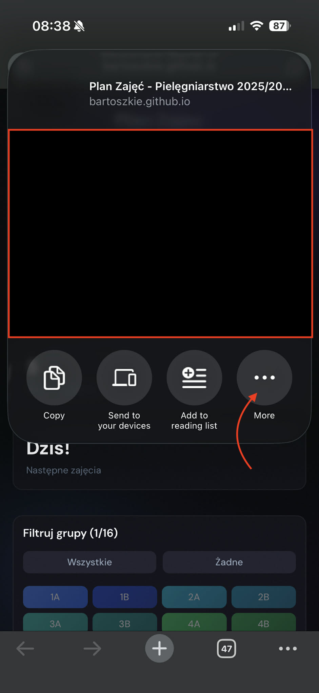
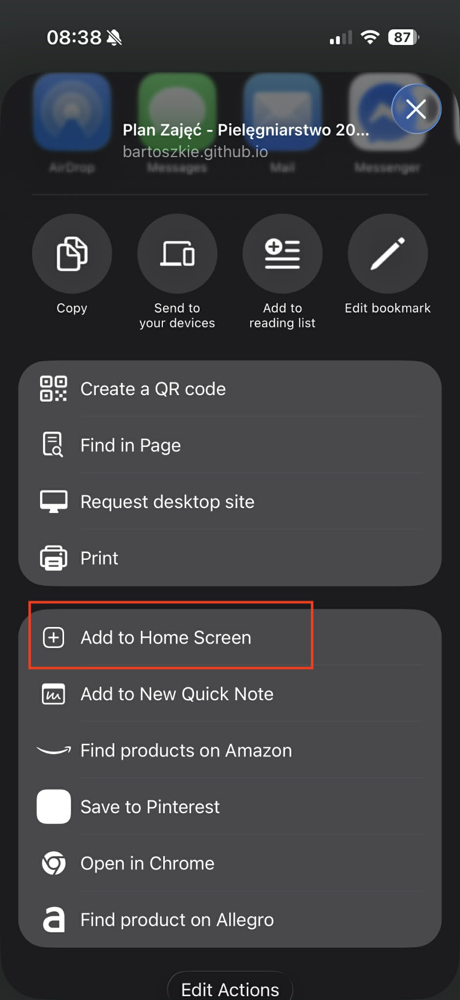
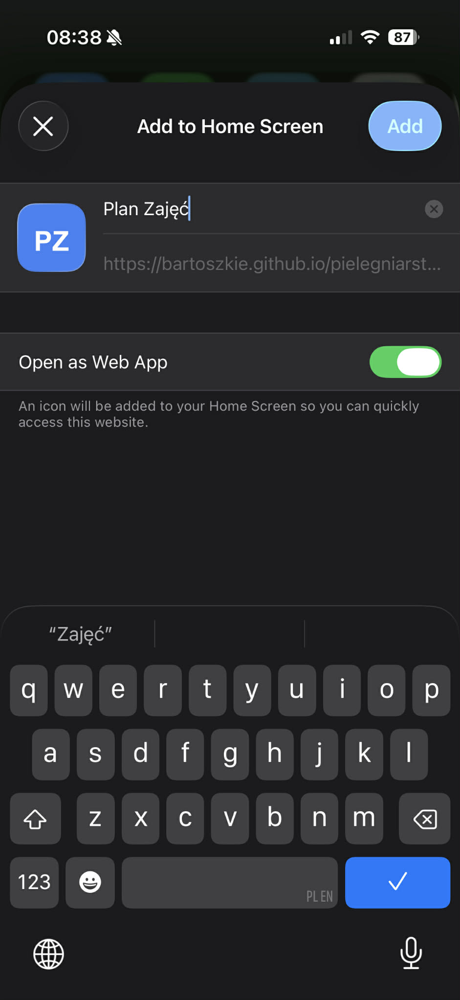

# 1. Instalacja

[← Spis treści](../README.md) · **Instalacja** · [Instrukcja →](2-instrukcja.md)

Aplikację instaluje się prosto z przeglądarki, bez App Store i Google Play. Zajmuje to mniej niż minutę.

- [iPhone (Safari lub Chrome)](#iphone-safari-lub-chrome)
- [Android (Chrome)](#android-chrome)

---

## iPhone (Safari lub Chrome)

1. Otwórz **[bartoszkie.github.io/pielegniarstwo-lessons](https://bartoszkie.github.io/pielegniarstwo-lessons/)** w Safari albo w Chrome.
2. Stuknij przycisk **Udostępnij** (kwadrat ze strzałką do góry):
   - w **Chrome** jest w pasku adresu, na górze ekranu;
   - w **Safari** jest na dolnym pasku. W nowszych wersjach iOS najpierw stuknij **⋯** obok paska adresu, a potem **Udostępnij**.

   

3. Jeśli na liście nie widać opcji z kolejnego kroku, stuknij **Więcej**.

   

4. Wybierz **Dodaj do ekranu początkowego**.

   

5. Zostaw nazwę **Plan Zajęć**. Sprawdź, że przełącznik **Otwórz jako aplikację internetową** jest włączony, i stuknij **Dodaj**.

   

6. Na ekranie głównym pojawi się ikona **Plan Zajęć**. Od teraz otwieraj aplikację z niej, a nie z przeglądarki.

> Zrzuty pochodzą z iPhone'a z angielskim językiem systemu. Po polsku przyciski nazywają się tak jak w opisie kroków.

## Android (Chrome)

1. Otwórz **[bartoszkie.github.io/pielegniarstwo-lessons](https://bartoszkie.github.io/pielegniarstwo-lessons/)** w Chrome.
2. Jeśli na dole ekranu pojawi się propozycja **Zainstaluj aplikację**, stuknij ją i przejdź do kroku 5.
3. W przeciwnym razie stuknij menu **⋮** w prawym górnym rogu.
4. Wybierz **Dodaj do ekranu głównego** lub **Zainstaluj aplikację**.
5. Potwierdź przyciskiem **Zainstaluj** (lub **Dodaj**).
6. Ikona **Plan Zajęć** pojawi się na ekranie głównym i na liście aplikacji.

---

**Gotowe?** Przejdź do [instrukcji](2-instrukcja.md), żeby wczytać plan i wybrać swoją grupę.

[← Spis treści](../README.md) · [Instrukcja →](2-instrukcja.md)
