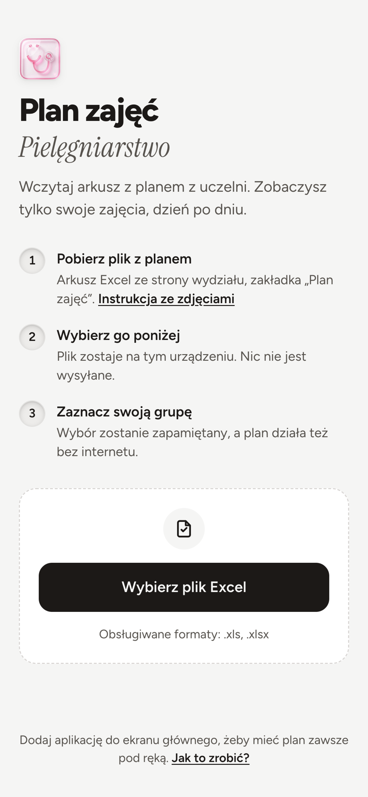
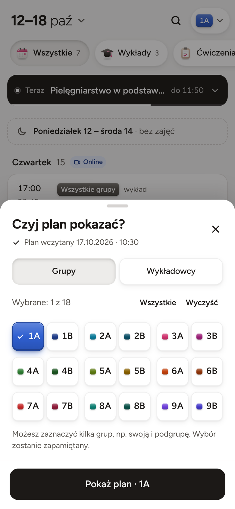
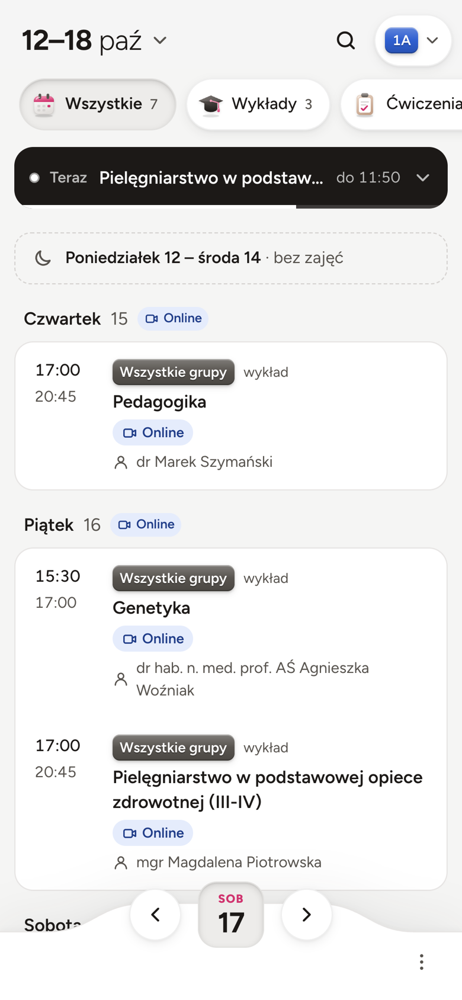
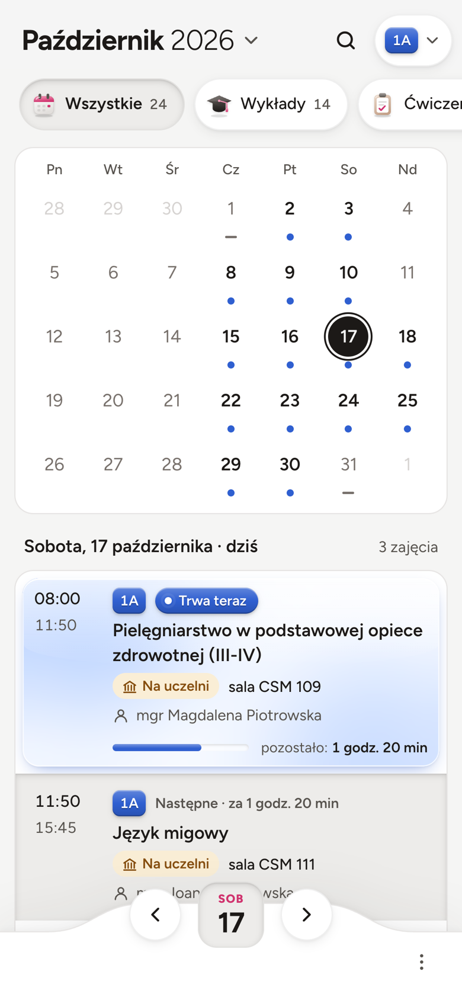
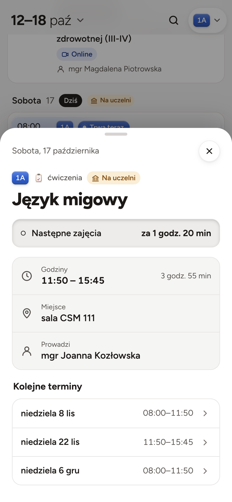
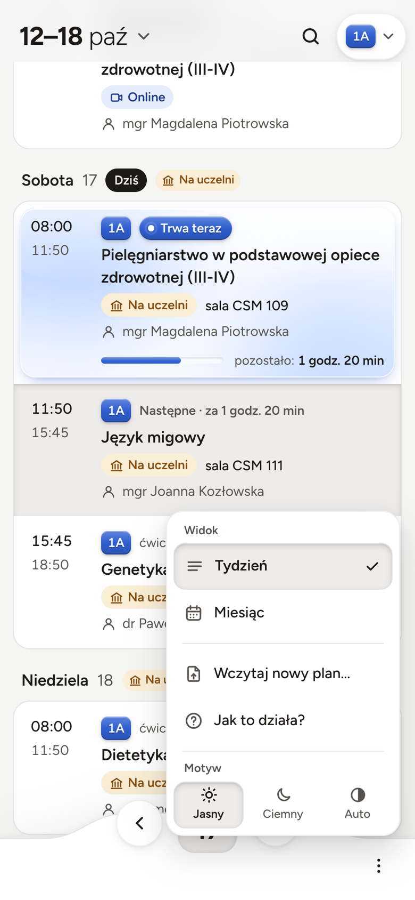
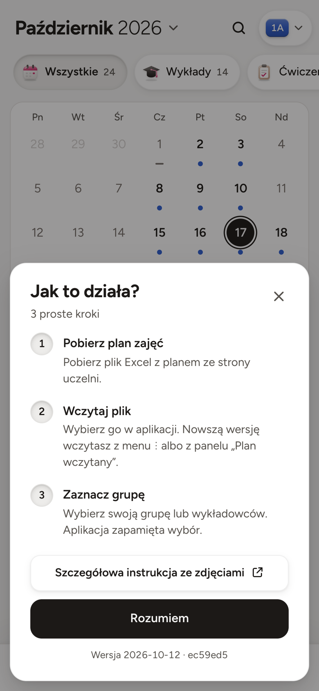

# 2. Instrukcja

[← Instalacja](1-instalacja.md) · [Spis treści](../README.md) · [Aktualizacje →](3-aktualizacje.md)

Jak zacząć i jak korzystać z aplikacji na co dzień.

1. [Pobierz plik z planem](#1-pobierz-plik-z-planem)
2. [Wczytaj plik](#2-wczytaj-plik)
3. [Zaznacz swoją grupę](#3-zaznacz-swoją-grupę)
4. [Przeglądaj plan](#4-przeglądaj-plan)
5. [Menu ⋮](#5-menu-)
6. [Uwagi](#uwagi)

---

## 1. Pobierz plik z planem

Pobierz arkusz Excel (`.xls` lub `.xlsx`) z planem ze strony wydziału, z zakładki „Plan zajęć”. Zapisz go w telefonie, np. w aplikacji Pliki albo w Pobranych.

## 2. Wczytaj plik

Stuknij **Wybierz plik Excel** i wskaż pobrany arkusz. Na komputerze możesz też po prostu przeciągnąć plik do okna.

## 3. Zaznacz swoją grupę

Po wczytaniu pliku zaznacz swoją grupę. Możesz wybrać kilka, np. swoją i podgrupę. Na karcie **Wykładowcy** możesz zamiast tego wybrać prowadzących. Stuknij **Pokaż plan**. Wybór zostanie zapamiętany.

Grupę zmienisz później przyciskiem z jej nazwą w prawym górnym rogu (np. **1A**).

## 4. Przeglądaj plan

- **Tydzień:** zajęcia dzień po dniu. U góry widać, co trwa teraz i ile zostało do końca. Dni wolne są zebrane w jedną linijkę.
- **Filtry** pod nagłówkiem (**Wszystkie**, **Wykłady**, **Ćwiczenia**…) pokazują tylko wybrany rodzaj zajęć.
- **Strzałki** na dole przełączają tygodnie. Data pośrodku wraca do dzisiaj.
- **Lupa** szuka zajęć po nazwie przedmiotu, prowadzącym lub sali.
- Oznaczenia **Online** i **Na uczelni** od razu mówią, czy trzeba jechać na zajęcia.

  
  

Stuknij zajęcia, żeby zobaczyć **szczegóły**: godziny, salę, prowadzącego i kolejne terminy tego przedmiotu.

## 5. Menu ⋮

Przycisk **⋮** w prawym dolnym rogu otwiera menu:

- **Tydzień / Miesiąc** zmienia widok.
- **Wczytaj nowy plan…** służy do wczytania nowszej wersji pliku, gdy uczelnia zmieni plan. Wybór grup zostaje zachowany.
- **Jak to działa?** to krótka instrukcja i numer wersji aplikacji.
- **Motyw** przełącza tryb jasny, ciemny lub automatyczny (jak w telefonie).

  
  

---

## Uwagi

- Plik Excel jest czytany wyłącznie na Twoim urządzeniu. Nic nie jest wysyłane na serwer.
- Jeśli coś w planie wygląda podejrzanie, porównaj to z plikiem Excel. Arkusz z uczelni często zawiera błędy, a niektóre jego wersje mogą zmylić aplikację. Wiersze, których nie udało się odczytać, aplikacja pokazuje jako **Uwagi do pliku**.
- Po wczytaniu nowszego pliku warto sprawdzić, czy wybrane grupy nadal się zgadzają.

> Nazwiska prowadzących na zrzutach ekranu są przykładowe.

---

[← Instalacja](1-instalacja.md) · [Spis treści](../README.md) · [Aktualizacje →](3-aktualizacje.md)
